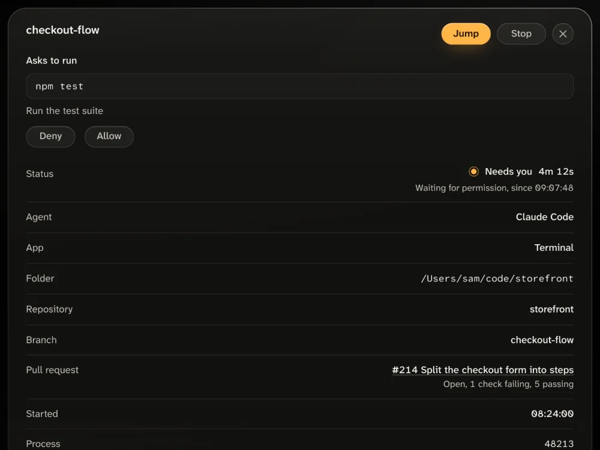

The Jump button is in the Needs you panel, in the Sessions list or on a session's card on the board, and in a session's details. Only Claude Code sessions have it. For another agent, such as Codex or Gemini CLI, switch to its session yourself. Jump never sends keys or text to a session.

<picture>
  <source media="(prefers-color-scheme: light)" srcset="../site/assets/features/jump-stop-day-1000.webp">
  
</picture>

## Where Jump works

Find where your session runs:

| The session runs in                        | macOS | Linux | Windows |
| ------------------------------------------ | ----- | ----- | ------- |
| VS Code, through the Claude Code extension | Yes   | Yes   | Yes     |
| A tmux pane                                | Yes   | Yes   | No      |
| A tab of Terminal or iTerm2                | Yes   | No    | No      |

A session in the Claude Code desktop app has no button. Nor does one in another terminal, such as Warp or Ghostty, unless it runs inside tmux there. A session on another machine has none. A session whose process has ended has none either, unless it is in VS Code.

## Terminal or iTerm2 on a Mac

You need Claude Code running directly in the tab. A session inside tmux is reached through tmux, even when tmux runs in a Terminal tab. A session inside another program that makes its own terminal, such as `script`, gets no button.

1. Open a Terminal tab, and start Claude Code in your project folder:

   ```bash
   cd ~/code/storefront
   claude
   ```

2. Open another tab, and start Agent Lookout. The first time, npm asks `Ok to proceed? (y)`. Press Enter.

   ```bash
   npx agent-lookout
   ```

3. Open the address it prints, `http://127.0.0.1:4777`. Within a few seconds the session has a Jump button. Point at it, or move to it with Tab, to read where it goes: `Terminal`.
4. Press Jump. The tab comes forward, and the row says "Switched to Terminal".

   If macOS asks whether the program you started Agent Lookout from may control Terminal, choose Allow. macOS remembers the answer and does not ask again. While it asks, the row says "macOS will ask once whether the app you started Agent Lookout from may control Terminal. Allow it to let Jump switch tabs."

iTerm2 works the same way. Its window, tab and pane are selected, and the row says "Switched to iTerm2". In the [Mac app](GUIDE.md#desktop-app), macOS's question names Agent Lookout, and the row says "whether Agent Lookout may control" instead. Jump does not need the Accessibility permission.

To change the answer later, open System Settings, then Privacy & Security, then Automation. Under the program you start Agent Lookout from, turn Terminal or iTerm2 on or off. macOS gives this permission to that program as a whole, so anything else you run from it can control Terminal too.

## tmux

You need macOS or Linux, and Agent Lookout started where the `tmux` command reaches the session's server: inside that server, or outside tmux for the default server. A session in another server, such as one started with `tmux -L`, gets no button.

1. Start a tmux session in your project folder, and start Claude Code in its first window:

   ```bash
   cd ~/code/storefront
   tmux new-session -s checkout-flow
   claude
   ```

2. Open a second window with your prefix and `c` (Ctrl+B, then c, unless you changed the prefix). Start Agent Lookout there:

   ```bash
   npx agent-lookout
   ```

3. Open `http://127.0.0.1:4777` in your browser, and point at the session's Jump button. It reads `tmux, checkout-flow:0.0`: the tmux session's name, then the window's and the pane's numbers, as your tmux counts them.
4. Press Jump. The row says "Selected in tmux", and your terminal shows Claude Code's window again, with its pane selected. Jump does not bring your terminal app to the front, so switch to it yourself.

A terminal attached to another tmux session of the same server switches to the pane's session too. With no terminal attached, you see the pane when you next attach.

To see what Agent Lookout sees, run this in a shell like the one you start it from. It should list a pane of `checkout-flow`. If it does not, Agent Lookout reaches another tmux server than the one the session runs in.

```bash
tmux -u list-panes -a -F '#{pane_pid} #{pane_id} #{window_index} #{pane_index} #{session_name}'
```

## VS Code

You need a session started by Claude Code's VS Code extension. A `claude` you run in VS Code's own terminal is a terminal session, and has a button only inside tmux. Before you press Jump, open the session's folder in the VS Code window that has focus. Otherwise VS Code starts a new conversation.

Here Jump is a link your browser opens, `vscode://anthropic.claude-code/open?session=<session ID>`. On Linux and Windows, it works where VS Code has registered itself to open those links. Agent Lookout's server takes no part, so the row shows no outcome after the press.

## Troubleshooting

### No Jump button

- **Symptom:** A Claude Code session that runs in tmux, in VS Code or in a Terminal or iTerm2 tab has no Jump button.
- **Cause:** Agent Lookout found no window it can reach. In tmux, the session runs in a server Agent Lookout does not reach, such as one started with `tmux -L`, or the default server while Agent Lookout runs inside another one. In a Terminal or iTerm2 tab, Claude Code runs inside another program that makes its own terminal, such as `script`. In VS Code, Agent Lookout cannot read the session registry at `~/.claude/sessions`, so it cannot tell which app the session runs in. A session that has just started is also a few seconds without its button. With `AGENT_LOOKOUT_TMUX` or `AGENT_LOOKOUT_TERMINAL_JUMP` set to `off`, that part finds nothing.
- **Fix:** For tmux, run the `list-panes` command above. If the session's pane is not listed, start Agent Lookout where `tmux` reaches the session's server. For Terminal or iTerm2, start Claude Code directly in the tab. For VS Code, start Agent Lookout with your own `HOME`, on the computer where VS Code runs. If you set `AGENT_LOOKOUT_CLAUDE_HOME`, point it at the Claude Code folder that holds `sessions`.

### "No tmux pane found" or "No tab found"

- **Symptom:** You press Jump, and the row says "No tmux pane found", or "No tab found" for a session in Terminal or iTerm2.
- **Cause:** Agent Lookout knows no pane or tab for the session now, as when it has ended or left tmux since the page last heard of it.
- **Fix:** Wait for the row to catch up. A session with no pane or tab to reach loses its button. If it still runs where Jump works, see [No Jump button](#no-jump-button).

### "macOS did not allow it"

- **Symptom:** You press Jump on a session in Terminal or iTerm2, and the row says "macOS did not allow it", with "To let Jump switch tabs, allow it in System Settings, Privacy & Security, Automation."
- **Cause:** macOS refused to let the program Agent Lookout runs in control the app. You chose Don't Allow, or the switch for that app is off.
- **Fix:** Open System Settings, then Privacy & Security, then Automation. Under the program you start Agent Lookout from, or under Agent Lookout in the Mac app, turn on Terminal or iTerm2. Then press Jump again.

### "Jump did not work" after about a minute

- **Symptom:** The first press on a session in Terminal or iTerm2 waits, then the row says "Jump did not work". Another Jump pressed meanwhile says "Try again in a moment".
- **Cause:** Agent Lookout waits up to a minute for macOS's question to be answered, and the page a few seconds more. Nobody answered in time, so the press timed out.
- **Fix:** Press Jump again, and choose Allow when macOS asks.

## How it works

Agent Lookout reads Claude Code's session registry, `~/.claude/sessions`. Each file names the app a session was started from, in its `entrypoint`. A session started by the VS Code extension gets its link from that. For a session whose process runs, Agent Lookout follows the process up through its parents. It stops at the process tmux started in a pane or, on macOS, at the Terminal or iTerm2 program. A pane comes before a tab, and on the page a VS Code link comes before both. A press selects the pane by its own ID, or runs `osascript` with a fixed script that brings the tab forward.

To turn off the tmux part, set `AGENT_LOOKOUT_TMUX=off`. To turn off the tab part, set `AGENT_LOOKOUT_TERMINAL_JUMP=off`. Nothing turns off the VS Code link.

```bash
AGENT_LOOKOUT_TMUX=off AGENT_LOOKOUT_TERMINAL_JUMP=off npx agent-lookout
```

The [Jump section of the guide](GUIDE.md#jump) has more. [PRIVACY.md](../PRIVACY.md#tmux) lists every command Jump runs and what it reads, and [API.md](API.md#post-apijump) describes the request a press sends.

## Next steps

- [Answer a permission prompt](GUIDE.md#answer-a-permission-prompt): answer with Allow or Deny from the page, without switching to the session.
- [Quickstart](quickstart.md): start Agent Lookout and jump to your first waiting session.
- [GitHub issues](https://github.com/Olanetsoft/agent-lookout/issues): ask a question or report a problem.
