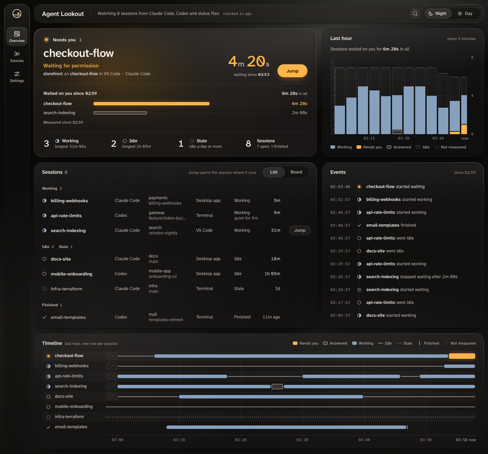

Agent Lookout is a local dashboard for the coding agent sessions running on your machine: Claude Code and Codex, and the other agents below.

When you run several coding agents at once, one of them often stops to ask you something while you are looking at another. Agent Lookout reads the sessions on your machine, shows them on one page, and puts the ones waiting on you first.

<picture>
  <source media="(prefers-color-scheme: light)" srcset="images/dashboard-day.png">
  
</picture>

## Get started

```bash
npx agent-lookout
```

Then open http://127.0.0.1:4777. You need Node.js 22.12 or newer, on macOS, Linux or Windows. On a Mac you can use the [Mac app](https://github.com/Olanetsoft/agent-lookout/releases/latest) instead, which needs macOS 13 or later and no Node.js. The [Quickstart](quickstart.md) takes you from there to your first jump.

## What you can do

- **See every session on one page,** with each one's status, folder and branch.
- **See who needs you first.** The Needs you panel lists the sessions waiting for you, longest wait first, with the reason, such as Waiting for permission. For Claude Code it also shows what the session asks, such as `Run: npm test`.
- **Jump to the session.** Jump opens a Claude Code session in VS Code, selects its tmux pane, or brings its Terminal or iTerm2 tab forward on a Mac.
- **Let your agents ask.** `agent-lookout mcp` is a read-only MCP server that an agent can ask which sessions are running and which need you.

Some of this depends on your system: on Windows, Jump reaches VS Code only, and there is no Stop, Allow or Deny. [What works on each system](../README.md#supported-agents-and-systems) has the full table.

## Supported agents

It finds these with no setup:

| Agent                                                           | Shows when it needs you                  |
| --------------------------------------------------------------- | ---------------------------------------- |
| Claude Code                                                     | Yes                                      |
| Antigravity and the Antigravity CLI                             | Yes, while it asks you to approve a step |
| Codex                                                           | No: a waiting session shows as working   |
| Mistral Vibe, Gemini CLI, OpenCode and Qwen Code                | No                                       |
| Any agent that writes a [status file](GUIDE.md#your-own-agents) | Yes, when it writes that it waits        |

Mistral Vibe, Gemini CLI, OpenCode and Qwen Code support was built from their source and has not yet been checked on a machine running them. [What each agent can report](GUIDE.md#what-each-agent-can-report) has the details.

## Privacy

- It never starts a session, types into one or sends it a message of yours.
- It acts on a session only when you press Allow, Deny or Stop, or by a permission rule you set in Settings. Stop asks you to confirm. Allow, Deny and rules need its Claude Code plugin.
- It listens on this machine only, and by default sends nothing off it.

> **What can leave your machine.** The Mac app checks GitHub for a new version about once a day, which Settings turns off, and installs its Claude Code plugin once. Claude Code's own `claude agents` command, which Agent Lookout runs, may contact Anthropic. Email, webhooks, phone pushes, pull requests and other machines stay off until you set them up. [PRIVACY.md](../PRIVACY.md) lists everything it reads, runs and sends.

## Next steps

- [Quickstart](quickstart.md): start it with npx, find a Claude Code session that waits for your approval, and jump to it.
- [Jump to a session's window](guide-jump-to-window.md): set up Jump for VS Code, tmux, and Terminal or iTerm2 on a Mac, and fix it when it fails.

## Get help

Ask a question or report a problem in [GitHub issues](https://github.com/Olanetsoft/agent-lookout/issues). The [full guide](GUIDE.md) covers every part of the dashboard.
