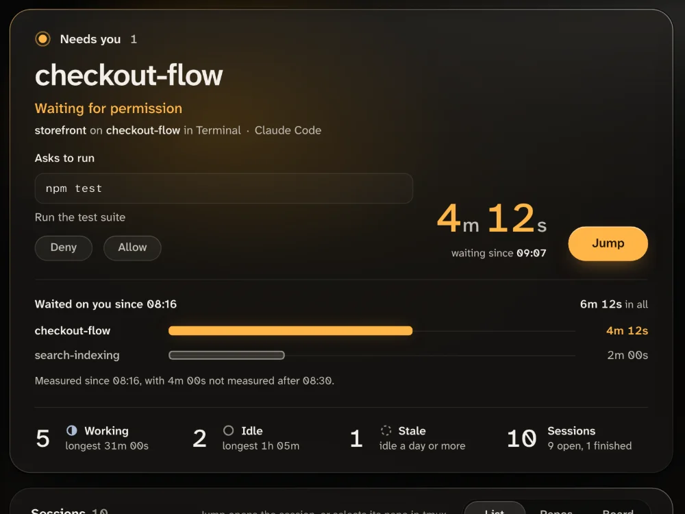

## Before you begin

You need these, and about five minutes:

- Node.js 22.12 or later. Check with `node --version`.
- Claude Code, run in a Terminal or iTerm2 tab on a Mac, inside tmux on macOS or Linux, or in its VS Code extension. Codex sessions show up too, but never as waiting for you.

## Steps

1. **Start Agent Lookout.** Run this from any folder that is not a clone of the agent-lookout repository. The first time, npm asks `Ok to proceed? (y)`: press Enter.

   ```bash
   npx agent-lookout
   ```

   ```text
   Agent Lookout is running at http://127.0.0.1:4777
   It listens on this machine only. Press Ctrl+C to stop.
   ```

   Open http://127.0.0.1:4777. Your sessions appear within a few seconds.

   <details>
   <summary>It did not start, or shows no session?</summary>
   - **"Agent Lookout needs Node.js 22.12 or newer"**: install Node.js 22.12 or later, then run it again.
   - **"Port 4777 is already in use"**: another program has the port. Run `npx agent-lookout --port 4778`, and open http://127.0.0.1:4778.
   - **"Cannot find package 'tsx'"**: you ran it inside a clone of the agent-lookout repository. Run it from another folder.
   - **The page shows no session**: see [No sessions appear](GUIDE.md#no-sessions-appear).

   </details>

2. **Make a session wait for you.** In another terminal, start Claude Code in a project and ask for something that runs a command:

   ```bash
   cd ~/code/storefront
   claude
   ```

   ```text
   Run npm test and tell me what fails.
   ```

   Claude Code stops to ask your permission before it runs `npm test`, unless your settings already allow it.

3. **Read what it asks.** Within a few seconds the Needs you panel, at the top of the Overview, shows the session: Waiting for permission, what it asks, where it runs, and how long it has waited. With Agent Lookout's Claude Code plugin, it also offers Deny and Allow.

   <picture>
     <source media="(prefers-color-scheme: light)" srcset="../site/assets/features/needs-you-day-1000.webp">
     
   </picture>

4. **Jump to it.** Press Jump, beside the timer. Agent Lookout brings the session's Terminal or iTerm2 tab to the front, selects its tmux pane, or opens it in VS Code. The row then says "Switched to Terminal", "Switched to iTerm2" or "Selected in tmux". For VS Code it says nothing, and VS Code opens the session.

   The first jump to a Terminal or iTerm2 tab makes macOS ask whether the app you started Agent Lookout from may control it. Choose Allow.

   Answer the prompt in the session, and it leaves Needs you. If the session has no Jump button, see [Jump to a session's window](guide-jump-to-window.md).

5. **Stop Agent Lookout.** Press Ctrl+C where it runs. Nothing keeps running. The history behind its charts stays in `~/.agent-lookout/history`; start it with `AGENT_LOOKOUT_HISTORY=off` to keep none.

## Next steps

- [Jump to a session's window](guide-jump-to-window.md): how Jump reaches each app, and what to do when it fails.
- [Answer a permission prompt](GUIDE.md#answer-a-permission-prompt): install the Claude Code plugin to answer with Allow and Deny from the page.
- [Introduction](introduction.md): what Agent Lookout does, and what it leaves alone.
- [GitHub issues](https://github.com/Olanetsoft/agent-lookout/issues): ask a question or report a problem.
